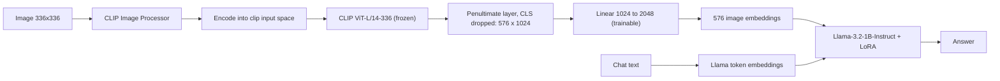

# README

# Mini-LLaVA: Visual Instruction Tuning with a 1B language model

A small, reproducible re-implementation of the two-stage recipe from [*Visual Instruction Tuning*](https://arxiv.org/abs/2304.08485) (LLaVA), built from **CLIP ViT-L/14-336** and **Llama-3.2-1B-Instruct** and trained on a single GPU.

> The learning xperience behind this project (the mistakes, dead ends and fixes) is in [**ABOUT.md**](ABOUT.md).
This file is the technical reference: what it is, how to run it, how to reproduce it, how to check that it works.
> 
- LLaVAMustBeCold —> Stage 1
- LLaVAMustBeHot   —> Stage 2
- LLaVAMustTell         —> Inference

---

## What this is

A vision-language assistant that can describe an image and answer multi-turn questions about it.

- **Frozen vision encoder:** CLIP ViT-L/14 at 336 px. Features come from the **penultimate layer with the CLS token removed**, giving 576 tokens × 1024 dimensions.
- **Projector (Bridge):** One trainable linear layer, 1024 → 2048, that maps image features into the LLM’s embedding space.
- **Language model:** Llama-3.2-1B-Instruct, fine-tuned with **LoRA** in LLaVAMustBeHot (Stage 2).
- **Trainable parameters:** About 13M in total (about 11.3M LoRA + 2.1M projector, computed from the config; check the printout in the code).

### What this is not

It is a learning project, not a state-of-the-art model. It uses a 1B language model, one epoch of instruction tuning, and has **not** been evaluated on standard benchmarks (VQAv2, GQA, POPE, …).

### Differences from the paper

|  | Paper (LLaVA / LLaVA-1.5) | This project |
| --- | --- | --- |
| Vision encoder | CLIP ViT-L/14 (336 px in 1.5), frozen | CLIP ViT-L/14-336, frozen |
| LLM | Vicuna 7B / 13B | Llama-3.2-1B-Instruct |
| Connector | Linear (MLP in 1.5) | Single linear layer |
| Stage 1 | CC3M-595K captions, projector only | First 200K of the same set, projector only |
| Stage 2 | 158K instruction samples, full LLM fine-tune | 156,564 samples, **LoRA** + projector |
| Hardware | Multi-GPU A100 servers | One RTX Pro 5000 (Blackwell, 47 GiB) |

---

## Architecture



**Input layout** (identical in both training stages and at inference):

```
[BOS] [576 image embeddings] <|start_header_id|>user<|end_header_id|>\n\n{question}<|eot_id|><|start_header_id|>assistant<|end_header_id|>\n\n{answer}<|eot_id|> ...
```

- No system prompt.
- The image appears once, right after BOS. Later turns see it through causal attention.
- LLaVAMustBeCold (Stage 1)  uses the same layout with the caption in place of the chat turns.
- In LLaVAMustBeHot the loss is computed **only on assistant tokens** (including their `<|eot_id|>`). Image positions, BOS and user turns are masked with `100`.

---

## Results

| Check | Setup | Result |
| --- | --- | --- |
| Stage 1, held-out loss, **matched** images | 800 caption samples (not in training set) | 3.049 |
| Stage 1, held-out loss, **mismatched** images | Same captions, Images shifted by one (different image) | 4.802 (gap **1.753**) |
| Stage 2, held-out loss, real / shuffled / blank images | 100 held-out samples, about 40% through the epoch | 1.335 / 1.465 / 1.407 |
| Stage 2, final loss | Over 39980 training samples | Loss: 1.298 | Avg. Rolling Loss: 1.388 |

Notes:

- *Shuffled* = the same text with another sample’s image. *Blank* = an all-zero pixel tensor. If the model uses the image, real should be clearly lower than both. See [How to verify the model sees the image](about:blank#how-to-verify-the-model-sees-the-image).
- Before Stage 2 training, the same test on a different set of 100 samples gave 1.586 / 1.643 / 1.584. The sets differ, so treat that comparison as directional.
- Final Inference Results:

`Enter Prompt: what is in this image?` 

`Answer: The image features a beach scene with a palm tree and a palm tree with a boat in` `background. The palm tree is located near the water, and the boat is floating on the water.`

---

## Quickstart: run inference on a free Colab T4 / Kaggle

1. Accept the licence for [`meta-llama/Llama-3.2-1B-Instruct`](https://huggingface.co/meta-llama/Llama-3.2-1B-Instruct) on Hugging Face.
2. Create a Hugging Face **read** token. In Colab, open the 🔑 *Secrets* panel, add it as `HF_TOKEN` and enable notebook access. Never paste a token into a cell.
3. Open `/LLaVAMustTell.py`, set the runtime to **T4 GPU**, and run all cells.
4. Ask questions:

```python
bot = LLaVAChat()
bot.set_image(load_image("http://images.cocodataset.org/val2017/000000039769.jpg"))
print(bot.ask("What is in this image?"))
print(bot.ask("How many animals are there?"))                                   # multi-turn: history is kept
bot.set_image(img)                                                              # new image resets the chat
print(bot.ask("Provide a detailed description of the given image.", max_new_tokens=350))
```

Conversation, detail and reasoning “modes” are just different questions and `max_new_tokens`. The model was trained on all three styles with the same chat format.

The T4 has no native bf16, so the notebook runs fp16. If answers look garbled or contain NaN, set `DTYPE = torch.float32` (it still fits).

---

## Weights and data

| Purpose | Name | Link |
| --- | --- | --- |
| Stage 1 data | LLaVA-CC3M-Pretrain-595K (`chat.json`, `images.zip`) | [https://huggingface.co/datasets/liuhaotian/LLaVA-CC3M-Pretrain-595K](https://huggingface.co/datasets/liuhaotian/LLaVA-CC3M-Pretrain-595K) |
| Stage 2 data | LLaVA-Instruct-150K (`conversation_58k.json`, `detail_23k.json`, `complex_reasoning_77k.json`) | [https://huggingface.co/datasets/liuhaotian/LLaVA-Instruct-150K](https://huggingface.co/datasets/liuhaotian/LLaVA-Instruct-150K) |
| Stage 2 images | COCO 2017 train | [http://images.cocodataset.org/zips/train2017.zip](http://images.cocodataset.org/zips/train2017.zip) |
| Test images | COCO 2017 val | [http://images.cocodataset.org/zips/val2017.zip](http://images.cocodataset.org/zips/val2017.zip) |
| Vision encoder | CLIP ViT-L/14-336 | [https://huggingface.co/openai/clip-vit-large-patch14-336](https://huggingface.co/openai/clip-vit-large-patch14-336) |
| Language model (gated) | Llama-3.2-1B-Instruct | [https://huggingface.co/meta-llama/Llama-3.2-1B-Instruct](https://huggingface.co/meta-llama/Llama-3.2-1B-Instruct) |
| **Trained weights** | projector + LoRA adapter | [https://huggingface.co/datasets/KhanZaid-NL/LLaVA_Weights](https://huggingface.co/datasets/KhanZaid-NL/LLaVA_Weights) |
| Kaggle mirrors (optional) | COCO 2017 / instruction JSONs | [https://www.kaggle.com/datasets/awsaf49/coco-2017-dataset](https://www.kaggle.com/datasets/awsaf49/coco-2017-dataset) , [https://www.kaggle.com/datasets/khanzaid06/multiturndataset](https://www.kaggle.com/datasets/khanzaid06/multiturndataset) |

```bash
pip install -U huggingface_hub
export HF_TOKEN=<your token>        # needed for Llama; never commit it

# Stage 1 data (images.zip is large: check free disk space first)
hf download liuhaotian/LLaVA-CC3M-Pretrain-595K chat.json images.zip --repo-type dataset --local-dir data/cc3m
unzip -q data/cc3m/images.zip -d data/cc3m/images

# Stage 2 instruction data
hf download liuhaotian/LLaVA-Instruct-150K conversation_58k.json detail_23k.json complex_reasoning_77k.json \
  --repo-type dataset --local-dir data/instruct

# COCO 2017 images
wget http://images.cocodataset.org/zips/train2017.zip && unzip -q train2017.zip -d data/coco
wget http://images.cocodataset.org/zips/val2017.zip   && unzip -q val2017.zip   -d data/coco
```

(Older `huggingface_hub` installs use `huggingface-cli download` instead of `hf download`.)

Check the folder layout after unzipping (for example `data/coco/train2017/` versus `data/coco/train2017/train2017/`) and point the notebooks at the real path.

---

## Reproducing the training

### Hardware and environment

- Developed on one **NVIDIA RTX Pro 5000 (Blackwell), 47 GiB**, with a pod-based GPU service. Earlier debugging was done on Kaggle/Colab T4s.
- Blackwell GPUs need a PyTorch build with **CUDA 12.8 or newer**.
- Python packages: `torch`, `transformers`, `peft`, `accelerate`, `huggingface_hub`, `safetensors`, `Pillow`, `tqdm`. TODO: pin the versions you actually used in `requirements.txt`.
- Put data and checkpoints on a **persistent volume**, and decode images from extracted local files, not from a zip.

### Stage 1: Projector Alignment (`models/LLaVAMustBeCold.py`)

| Setting | Value |
| --- | --- |
| Data | First 200,000 CC3M caption pairs |
| Trainable | Projector only (LLM and CLIP frozen) |
| Caption length | 128 tokens total (image tokens are added on top) |
| Batch | 16 × 8 accumulation = 128 effective |
| Steps | 12,500 micro-batches (about 1,560 optimizer steps), 1 epoch |
| LR | 1e-3, warmup then cosine decay |
| Precision | bf16 autocast, projector weights in fp32 |
| Regularization | Gradient clipping at 1.0, non-finite loss/gradient steps skipped |
| Memory | About 26.5 GiB peak (gradient checkpointing on) |
| Speed | About 1.4-1.7 it/s, roughly 2 hours |
| Checkpoints | Every 512 micro-batches |

### Stage 2: Instruction Tuning (`models/LLaVAMustBeHot.py`)

| Setting | Value |
| --- | --- |
| Data | `conversation_58k` (56,681) + `detail_23k` (23,240) + `complex_reasoning_77k` (76,643) = **156,564** samples |
| Format | Llama-3 chat template, no system prompt, image after BOS, loss on assistant tokens only |
| Sequence length | 1,024 text tokens max (0.0% of sampled conversations were longer; p50/p90/p99 = 175/465/615 tokens) |
| Trainable | LoRA (r=16, alpha=32, dropout 0.05; q/k/v/o/gate/up/down) + projector |
| Init | Projector from Stage 1; LoRA B matrices at zero |
| LR | LoRA 2e-4, projector 2e-5; warmup about 3% then cosine |
| Batch | 4 × 8 accumulation = 32 effective |
| Steps | 39,141 micro-batches (4,892 optimizer steps), 1 epoch |
| Precision | bf16 autocast, fp32 trainable weights, gradient clipping 1.0 |
| Memory | 22.7 GiB peak in the smoke test; 26 GiB measured on a full-length dummy batch; gradient checkpointing **off** |
| Speed | About 3.8-4.1 it/s, roughly 2.5-3 hours |
| Checkpoints | Every 512 micro-batches (projector, LoRA adapter, optimizer, scheduler, step) |

### Resuming

Training resumes automatically if both `training_checkpoint.pt` and `lora_adapter/adapter_model.safetensors` exist in the checkpoint directory. A correct resume prints:

```
unexpected: []
LoRA B nonzero: True
Model Checkpoint Restored...Resuming Training from Epoch: 0 and Step: <multiple of 512>
```

Resuming requires the **same batch size, seed and data files**, because the saved step counts micro-batches and the data order is derived from the seed. The skip-ahead reloads skipped batches, so expect a delay of a few minutes Or use pre seeded permutation to shuffle the batch. In this case set `shuffle = False` in train `dataloader` 

---

## Sanity checklist before any long run

These tests were suggested by Claude, so review them.

Every one of these caught a real bug in this project (details in [ABOUT.md](ABOUT.md)).

1. **Missing-image check.** Every image path in your JSON must exist on disk; expect `0 missing`.
2. **Collate test.** Build a batch of 4 and assert `pixel_values.shape == (4, 3, 336, 336)`, that the image-token slot is correct, and that decoding the labels shows only assistant text.
3. **Feature check.** Confirm the vision features have shape `(B, 576, 1024)`, taken from `hidden_states[-2][:, 1:, :]`, and that two different images give different features.
4. **Worst-case memory test.** Run one forward/backward on a dummy batch at full `MAX_LENGTH`. The peak, not the average, decides whether you OOM.
5. **Probe before training** (real vs shuffled vs blank). It must run without errors.
6. **Smoke test.** Run about 24 micro-batches. Loss and gradient norm must be finite, and the run must **not** save or upload weights (guard the final save behind a flag).
7. **Save → load round trip.** Reload a saved checkpoint once and compare the weights.

## How to verify the model sees the image

A falling loss does not prove the model uses the image, because much of the answer text is predictable from the question. Use controls on held-out samples:

```python
@torch.no_grad()
def probe(model, batches, mode="real"):
    model.llama_model.eval(); total = 0.0
    for b in batches:
        px = b["pixel_values"]
        if mode == "shuffled": px = px.roll(1, dims=0)     # wrong image, same text
        elif mode == "blank":  px = torch.zeros_like(px)   # no visual content
        with torch.amp.autocast(device, dtype=MODEL_DTYPE):
            out = model(px, b["input_ids"].to(device), b["attention_mask"], b["labels"])
        total += out.loss.item()
    return total / len(batches)
```

- **Pass:** `real` is clearly below both `shuffled` and `blank`, and the gap widens as training goes on.
- **Fail:** the three numbers are almost equal. This is what a broken pipeline looked like here (1.6138 vs 1.6077).
- **Qualitative test:** run the same question on several unseen `val2017` images and on a plain gray image. Answers should differ per image, and the gray image should not get a confident description. Fluent text alone proves nothing.

---

## Troubleshooting (Documented Using Claude)

| Symptom | Likely cause | Fix |
| --- | --- | --- |
| Real, shuffled and blank losses are almost identical | Image features differ from what the projector was trained on (wrong layer, CLS kept, wrong index), or image placed before BOS | Use `hidden_states[-2][:, 1:, :]` and the `[BOS][image][text]` layout in every stage |
| Loss is NaN or inf | fp16 overflow, high LR, bad batch | bf16 autocast, fp32 projector, LR 1e-3 or lower in Stage 1, gradient clipping, skip non-finite steps |
| OOM in the forward pass | Long batch, large logits (128K vocabulary) | Smaller batch with more accumulation, or enable gradient checkpointing and keep the LLM in `train()` mode (it is silently skipped in `eval()`) |
| Gradient checkpointing has no effect | Hugging Face only checkpoints in training mode | Call `llama_model.train()` (Llama has no dropout) |
| `RuntimeError: Input type (cuda...) and weight type (CPU)` | CLIP or Llama still on the CPU | `model.to(device)` once after loading |
| `mat1 and mat2 must have the same dtype` | Projector converted to fp16 by a blanket `.half()`/`.to(dtype)` | Keep the projector in fp32 and cast its output to the model dtype |
| `ValueError: ... not used by the model: ['input_embeds']` | Typo | The argument is `inputs_embeds` |
| `load_state_dict` fails with `got <class 'method'>` | Saved `state_dict` without `()` | Re-save with `state_dict()`; the old file can be recovered by calling the loaded object |
| Resume starts from scratch or crashes on keys | Checkpoint key names changed between versions, adapter not restored | Use matching keys; load the LoRA adapter with `set_peft_model_state_dict` before the optimizer state |
| `HF_HOME` has no effect | Set after `transformers`/`datasets` were imported | Set it at the very top of the first cell |
| Every image reported missing | Wrong folder, still unzipping, or a path typo | `find` the real directory and re-check the count |
| Progress bar shows `N/?` after resume | `total` was set to the remaining batches | `total = len(loader) + start_step` |

---

## Repository layout

```
.
├── README.md
├── ABOUT.md
├── scripts/
│   ├── LLaVAMustBeCold.py
│   ├── LLaVAMustBeHot.py
│   └── LLaVAMustTell.py
├── requirements.txt          
└── LICENSE                   
```

---

## Limitations

- Small LLM (1B) with one epoch of instruction tuning: expect errors on counting, small text, exact colors and fine detail, and expect hallucinations.
- No standard benchmark results. The checks above show that the image is used, not how well it compares with published models.
- Training data is GPT-generated and COCO-centric, so it is English-only and strongest on everyday scenes.
- Greedy decoding by default; long answers can repeat (try `repetition_penalty=1.1`).

## Licences

- **Llama 3.2** is under Meta’s community licence (accept it on Hugging Face; it has attribution and naming conditions for derived models).
- **LLaVA instruction data** is GPT-generated and released for research use. **CC3M** and **COCO** images carry their own terms.
- Published Under MIT Licence

## Acknowledgments and citation

This project follows [LLaVA](https://github.com/haotian-liu/LLaVA) by Liu et al. 

```
@inproceedings{liu2023llava,
  title     = {Visual Instruction Tuning},
  author    = {Liu, Haotian and Li, Chunyuan and Wu, Qingyang and Lee, Yong Jae},
  booktitle = {NeurIPS},
  year      = {2023}
}

@article{liu2023improved,
  title   = {Improved Baselines with Visual Instruction Tuning},
  author  = {Liu, Haotian and Li, Chunyuan and Li, Yuheng and Lee, Yong Jae},
  journal = {arXiv:2310.03744},
  year    = {2023}
}
```